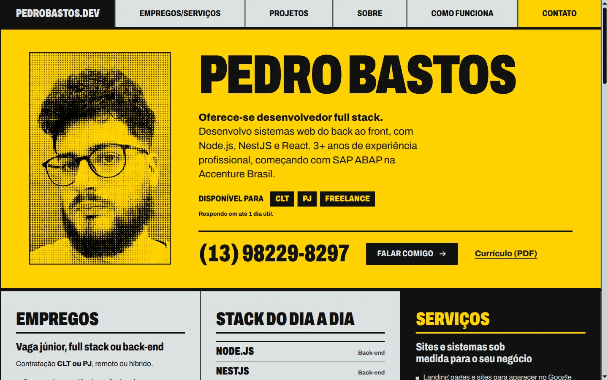
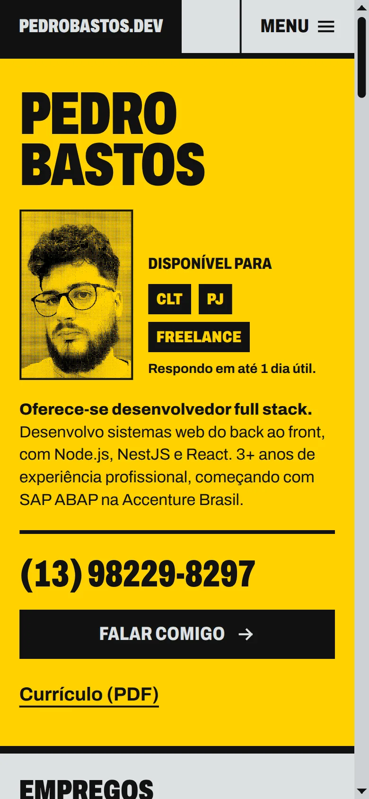
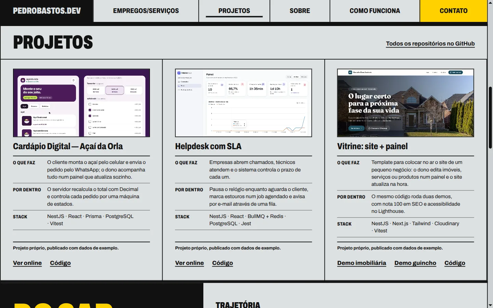

# pedrobastos.dev — Portfólio

> **Site:** [pedrobastosdev.github.io](https://pedrobastosdev.github.io) · **Currículo:** [PDF](assets/CV_Pedro_Bastos_Fullstack.pdf)

Meu site pessoal de desenvolvedor full stack (Node.js, NestJS e React). Ele fala com dois públicos com o mesmo peso: **empresas** que procuram um dev para vaga CLT ou PJ, e **donos de negócio** que precisam de um site ou sistema como freelance.

O visual imita uma página de **classificados de jornal**: papel cinza, tinta preta, um anúncio de destaque amarelo, foto em retícula e tipografia condensada em caixa alta (Archivo).

Feito em HTML, CSS e JavaScript puros, sem framework, sem build e sem dependências.

<p align="center">
  
  &nbsp;
  
</p>

## Seções

| Seção | O que mostra |
|---|---|
| **Apresentação** | Nome, foto, disponibilidade (CLT, PJ e freelance), telefone, botão "Falar comigo" e currículo |
| **Empregos · Stack · Serviços** | Três anúncios lado a lado: a vaga que procuro (com currículo e LinkedIn), a stack do dia a dia e os serviços para negócios (com orçamento pelo WhatsApp) |
| **Projetos** | [Cardápio Digital](https://github.com/pedrobastosdev/cardapio-acai), [Helpdesk com SLA](https://github.com/pedrobastosdev/helpdesk-sla) e [Vitrine](https://github.com/pedrobastosdev/vitrine-template), cada um com o que faz, o que tem por dentro, a stack e os links |
| **Sobre** | "Do SAP à web": a trajetória da Accenture (SAP ABAP) até a web, e a FATEC |
| **Como funciona** | O processo freelance em 4 passos e as formas de contratação (PJ mensal ou por demanda, freelance por projeto) |
| **Contato** | Formulário e os contatos diretos para empresas e para negócios |



## Detalhes

- **Formulário sem back-end:** valida cada campo com mensagem própria. Quem é empresa envia por e-mail e quem é dono de negócio envia pelo WhatsApp, os dois com a mensagem pronta. Se o app não abrir, aparece o outro caminho, e o texto digitado nunca se perde.
- **Perfil já marcado:** quem chega ao contato pelos links de Empregos ou de Serviços encontra o formulário com o perfil escolhido, e ao lado fica só o contato daquele público.
- **Menu:** todos os itens com a mesma altura. Em telas menores vira o botão "Menu", que fecha com `Esc`, ao tocar num item ou ao tocar fora.
- **Seção ativa:** o item do menu da seção que está na tela fica marcado.
- **Movimento:** só a entrada do anúncio de destaque, desligada para quem prefere menos movimento (`prefers-reduced-motion`).
- **Acessibilidade:** HTML semântico, link "pular para o conteúdo", foco visível, alvos de toque de 44 px e contraste AA em todos os textos.
- **Leve:** fonte e imagens hospedadas no próprio site, imagens em WebP com `loading="lazy"` e tamanho declarado, nenhuma biblioteca JavaScript.

## Estrutura

```
.
├── index.html
├── favicon.svg
├── css/
│   └── style.css      # cores, tipografia e medidas em variáveis no :root
├── js/
│   └── script.js      # menu, seção ativa, perfil do contato e formulário
├── fonts/             # Archivo (woff2)
├── img/               # foto, capturas dos projetos e imagem de compartilhamento (og.png)
├── assets/
│   └── CV_Pedro_Bastos_Fullstack.pdf
├── docs/              # imagens deste README
├── PRODUCT.md         # público, objetivo e regras de conteúdo
└── DESIGN.md          # sistema visual (cores, tipografia, componentes)
```

## Rodar localmente

Não precisa instalar nada: abra o `index.html` no navegador.

Para testar com um servidor local (mais próximo do GitHub Pages):

```bash
npx serve .
# ou
python3 -m http.server 8000
```

## Personalizar

| O quê | Onde |
|---|---|
| Cores, fontes e espaçamentos | variáveis no `:root` do `css/style.css` (`--paper`, `--ink`, `--yellow`…) |
| WhatsApp e e-mail do formulário | objeto `CONFIG` no topo do `js/script.js` |
| Textos do Sobre, dos passos e das formas de contratação | `index.html`, nos trechos marcados com `<!-- ✎ Texto editável -->` |
| Projetos | blocos `<article class="ad project">` no `index.html`; a imagem vai em `img/` em 16:10 |
| Currículo | substitua o arquivo em `assets/` mantendo o nome |

## Deploy

Publicado com **GitHub Pages** a partir da branch `main`, pasta raiz (`Settings → Pages`). Cada push na `main` atualiza o site em cerca de um minuto.

## Contato

[LinkedIn](https://linkedin.com/in/pedrobastosdev) · [Instagram](https://instagram.com/pedrobastos.dev) · [pedro.bastos.dev@proton.me](mailto:pedro.bastos.dev@proton.me)
