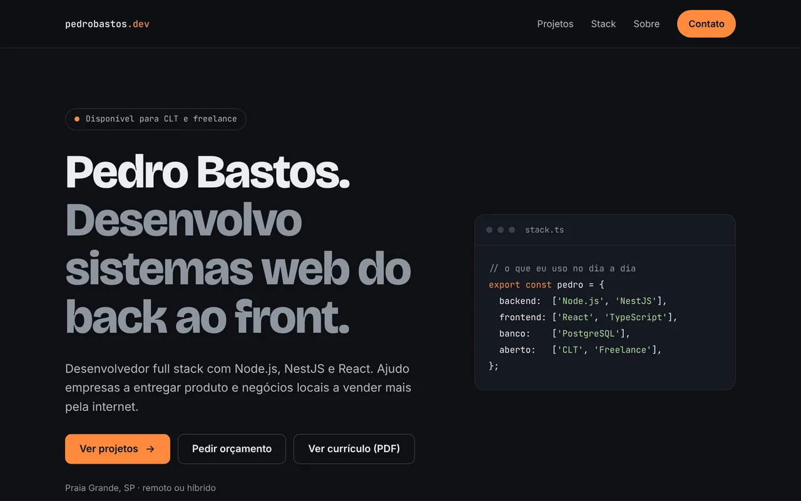
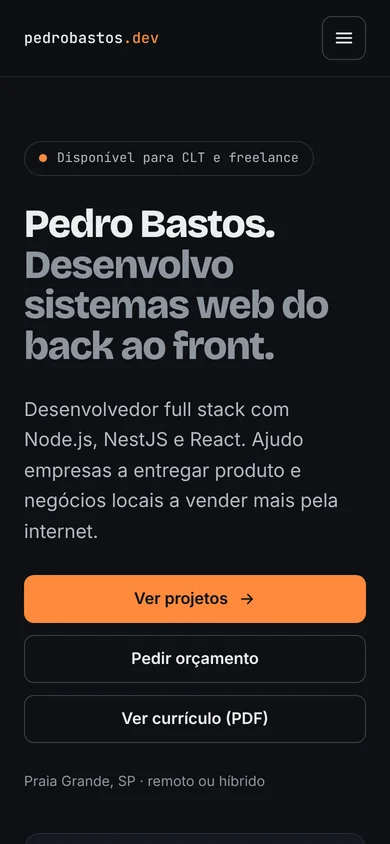
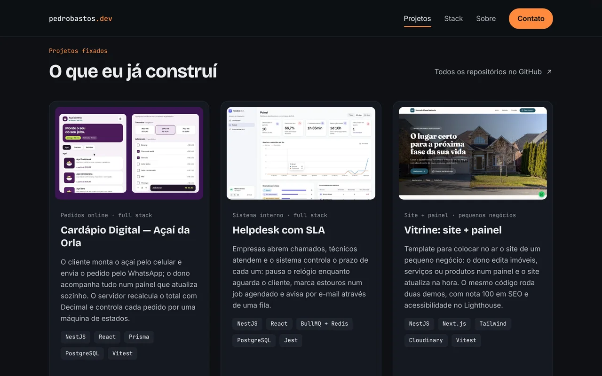

# pedrobastos.dev — Portfólio

> **Site:** [pedrobastosdev.github.io](https://pedrobastosdev.github.io) · **Currículo:** [PDF](assets/CV_Pedro_Bastos_Fullstack.pdf)

Meu site pessoal de desenvolvedor full stack (Node.js, NestJS e React). Ele fala com dois públicos ao mesmo tempo: **empresas** que procuram um dev para vaga CLT e **donos de negócio** que precisam de um site ou sistema como freelance.

Feito em HTML, CSS e JavaScript puros, sem framework, sem build e sem dependências.

<p align="center">
  
  &nbsp;
  
</p>

## Seções

| Seção | O que mostra |
|---|---|
| **Início** | Nome, proposta de valor e três atalhos: ver projetos, pedir orçamento e ver o currículo |
| **Dois jeitos de trabalhar comigo** | Um card para empresas (CLT) e outro para negócios (freelance), cada um com sua chamada |
| **Projetos fixados** | [Cardápio Digital](https://github.com/pedrobastosdev/cardapio-acai), [Helpdesk com SLA](https://github.com/pedrobastosdev/helpdesk-sla) e [Vitrine](https://github.com/pedrobastosdev/vitrine-template), com link para o site e para o código |
| **Stack** | Ferramentas principais e as que já usei |
| **Sobre** | Foto e trajetória |
| **Como funciona** | O processo de um projeto freelance em 4 passos |
| **Contato** | E-mail, WhatsApp, redes, currículo e um formulário |



## Detalhes

- **Formulário sem back-end:** valida os campos e abre o WhatsApp com a mensagem pronta, incluindo se quem escreveu é recrutador ou dono de negócio. Sem WhatsApp configurado, abre o e-mail.
- **Responsivo:** menu hambúrguer no celular, que fecha com `Esc` ou ao clicar num link.
- **Menu ativo:** o link da seção que está na tela fica destacado (`IntersectionObserver`).
- **Animações leves** ao rolar, desligadas para quem prefere menos movimento (`prefers-reduced-motion`).
- **Acessibilidade:** HTML semântico, link "pular para o conteúdo", foco visível, alvos de toque de 44 px e textos com contraste AA.
- **Leve:** imagens em WebP com `loading="lazy"` e tamanho declarado; nenhuma biblioteca JavaScript.

## Estrutura

```
.
├── index.html
├── css/
│   └── style.css      # cores e fontes em variáveis no :root
├── js/
│   └── script.js      # menu, seção ativa, animações e formulário
├── img/               # foto e capturas dos projetos
├── assets/
│   └── CV_Pedro_Bastos_Fullstack.pdf
└── docs/              # imagens deste README
```

## Rodar localmente

Não precisa instalar nada: abra o `index.html` no navegador.

Para testar com um servidor local (mais próximo do GitHub Pages):

```bash
npx serve .
# ou
python3 -m http.server 8000
```

## Personalizar

| O quê | Onde |
|---|---|
| Cor de destaque | `--accent` no topo do `css/style.css` (opções testadas: `#FF8A3D`, `#7CE3B1`, `#8AB4FF`, `#F2C14E`) |
| WhatsApp e e-mail do formulário | objeto `CONFIG` no topo do `js/script.js` |
| Projetos | blocos `<article class="card project">` no `index.html`; a imagem vai em `img/` em 16:10 |
| Currículo | substitua o arquivo em `assets/` mantendo o nome |

## Deploy

Publicado com **GitHub Pages** a partir da branch `main`, pasta raiz (`Settings → Pages`). Cada push na `main` atualiza o site em cerca de um minuto.

## Contato

[LinkedIn](https://linkedin.com/in/pedrobastosdev) · [Instagram](https://instagram.com/pedrobastos.dev) · [pedro.bastos.dev@proton.me](mailto:pedro.bastos.dev@proton.me)
